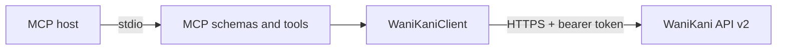

# Architecture

## Overview

Kani MCP Server is a local, single-user, read-only adapter between an MCP client and WaniKani API v2. It has no database, cache, background scheduler, or remote transport.

## Stack and components

- Node.js 18+ supplies `fetch`, URL handling, and the runtime.
- TypeScript provides strict source checking.
- `@modelcontextprotocol/sdk` implements MCP and stdio transport.
- Zod validates tool input at the MCP boundary.
- esbuild creates one executable ESM file for distribution.

`src/index.ts` reads configuration, creates the API client and MCP server, connects stdio, and closes on `SIGINT`. `src/server.ts` owns public tool names, descriptions, schemas, read-only annotations, and MCP result conversion. `src/client.ts` owns the API root, authentication and revision headers, query encoding, safe errors, and subscription-level enforcement.

## Request flow

1. The MCP SDK validates a tool call against its Zod schema.
2. The tool selects a fixed allowlisted WaniKani endpoint.
3. `WaniKaniClient` converts arrays to comma-delimited filters and performs an authenticated GET.
4. A successful upstream JSON value is serialized as indented JSON in MCP text content.
5. Validation failures are produced by the SDK; upstream/runtime failures return `isError: true` without credentials or arbitrary response bodies.

Subject calls first read `user.data.subscription.max_level_granted`. Collection requests are constrained to allowed levels, and singular subject responses above that level are rejected. This implements WaniKani's subscription restriction at the integration boundary.

## External contracts

The server pins the `Wanikani-Revision: 20170710` API revision. Collection endpoints remain cursor-paginated and the server returns one upstream page unchanged. It does not retry rate-limit failures because hidden retries can amplify load and delay an MCP call; callers see the 429 and can retry later.

There are no MCP resources or prompts. They would duplicate the tool surface without a demonstrated host workflow.

## Configuration

`WANIKANI_API_TOKEN` is required. `WANIKANI_API_BASE_URL` is an optional testing/advanced override. Remote roots must use HTTPS; loopback HTTP is allowed. The server writes only startup errors to stderr and reserves stdout for MCP.

## Deliberate boundaries

Writes, persistence, multi-user authentication, background sync, HTTP transport, caching, automatic pagination, and derived “leech” scoring are outside the first release. Each needs a concrete product use case and, for writes or persistence, a separate threat-model review.
